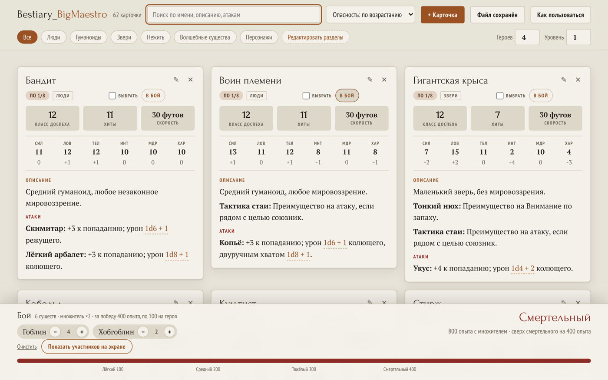

# Бестиарий

Бестиарий и калькулятор боя для D&D 5e — одним HTML-файлом. Открывается двойным кликом,
работает без интернета и без установки, хранит карточки внутри себя. Можно носить на флешке.



## Зачем

Мастеру за столом нужны статблоки под рукой и ответ на вопрос «потянет ли партия этот бой».
Обычно это либо стопка распечаток, либо сайт, который не открывается без сети.
Здесь всё в одном файле: карточки, поиск, расчёт сложности по правилам книги мастера
и бросок кубиков по клику.

## Возможности

**Карточки существ.** Класс доспеха, хиты, скорость, шесть характеристик с модификаторами,
описание, атаки, заметки мастера. Создаются и редактируются прямо на странице.

**Уровень опасности.** Считается по статблоку способом из DMG: защитная составляющая от хитов
с поправкой на класс доспеха, атакующая от урона за ход с поправкой на бонус попадания, затем
среднее. Расчётные значения помечены знаком `≈`, своё значение задаётся вручную и перебивает расчёт.

**Калькулятор боя.** Задаёте уровень и число героев, собираете стычку кнопкой «в бой».
Считается по DMG 2014: опыт за каждое существо, множитель за количество с поправкой на размер
партии, сравнение с порогами. Вердикт — от тривиального до смертельного, со шкалой и запасом
до следующей ступени.

**Броски.** Любое выражение с кубиками в тексте кликабельно и берётся целиком:
`2d6 + 1d8 + 3` выдаёт сумму и разбивку по каждому броску.

**Разделы, поиск, сортировка.** Свои разделы создаются, переименовываются и удаляются
с переносом карточек. Сортировка по опасности, имени, хитам, классу доспеха.

**Подборка на экране.** Галочками отмечаете любой набор карточек и оставляете на экране только
его. Отдельный режим боя показывает только участников стычки с количеством каждого.

**Светлая и тёмная тема** — по настройке системы.

## Как пользоваться

1. Скачайте нужный файл из [релизов](../../releases) или из репозитория.
2. Откройте его в браузере двойным кликом.
3. Правьте карточки, после чего нажмите **«Сохранить файл»**.
   Браузер скачает новый HTML со всеми изменениями внутри — замените им старый.

Пока изменения не записаны в файл, они держатся в памяти браузера, поэтому случайно закрытая
вкладка ничего не теряет. Кнопка подсвечивается, пока есть незаписанное.

Встроенная справка — кнопка «Как пользоваться» в шапке.

## Версии

| Файл | Что внутри |
|---|---|
| `Bestiary_Blank.html` | Пусто: ни карточек, ни разделов. Для своей кампании с нуля |
| `Bestiary_SRD.html` | 62 существа из SRD 5.1: люди, гуманоиды, звери, нежить, волшебные существа |
| `Bestiary_Full.html` | SRD плюс карточки кампании «Копи Фанделвера» |

## Как это устроено

Один файл без зависимостей: разметка, стили и скрипт внутри, шрифты (Forum, PT Serif,
PT Sans Narrow) вшиты как data-URI. Страница **не делает ни одного сетевого запроса** —
ни аналитики, ни CDN, ни шрифтов со стороны.

Данные лежат в двух JSON-блоках внутри самого файла:

```html
<script type="application/json" id="seed">[ … исходный бестиарий … ]</script>
<script type="application/json" id="saved">{ "creatures": {…}, "cats": {…}, "party": {…} }</script>
```

`seed` — карточки, с которыми файл собран. `saved` — ваши правки поверх них: изменённые
и добавленные карточки, свои разделы, настройки партии. При сохранении страница клонирует
собственный DOM, очищает сгенерированное и переписывает оба блока — поэтому новый файл
самодостаточен и его можно открыть на любой другой машине.

Удаление своей карточки стирает запись; удаление карточки из исходного бестиария вычёркивает
её из блока `seed` при следующем сохранении.

## Сборка

Файлы собираются Python-скриптом из JSON с существами, зависимостей нет:

```bash
python3 build.py seed.json Bestiary_SRD out/Bestiary_SRD.html "Люди,Звери,Нежить"
```

Аргументы: файл с существами, название, путь результата, список разделов через запятую,
необязательное примечание в справку. Шрифты подхватываются из `fonts_inline.css`, если он рядом.

## Требования

Современный браузер: Chrome 111+, Firefox 113+, Safari 16.2+ или новее
(страница использует CSS `color-mix`). Интернет не нужен.

## Ограничения

- Расчёт опасности не видит сопротивлений, иммунитетов и призыва подмоги — для таких существ
  он занижает оценку. Проставляйте уровень вручную там, где это важно.
- Сохранение идёт через обычное скачивание: браузер кладёт файл в папку загрузок,
  заменять старый нужно руками. Записать файл поверх себя страница не может — так устроены браузеры.
- Состав боя и отметки галочками живут один сеанс и в файл не попадают.

## Лицензии

Код — MIT, см. `LICENSE`.

Статблоки в `Bestiary_SRD.html` и часть `Bestiary_Full.html` взяты из
[Systems Reference Document 5.1](https://dnd.wizards.com/resources/systems-reference-document)
(Wizards of the Coast) и распространяются по лицензии
[CC BY 4.0](https://creativecommons.org/licenses/by/4.0/). Числовые характеристики — из SRD,
русские формулировки сокращены для удобства за столом.

Карточки кампании «Копи Фанделвера» — авторские, лицензией SRD не покрыты.
